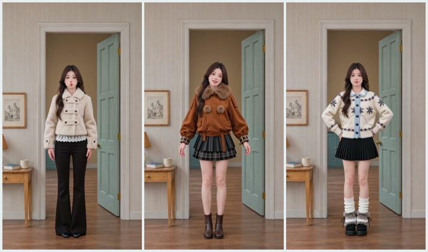
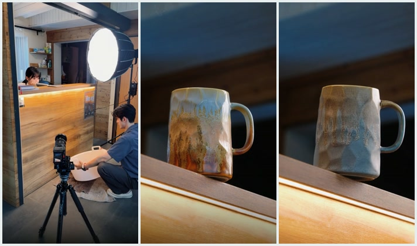
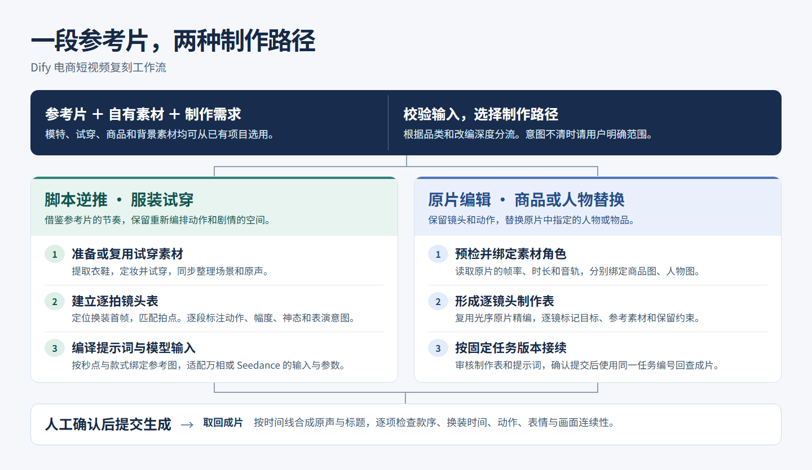

# Dify 电商短视频复刻工作流

让商家用自己的商品复刻高流量短视频的创意与节奏。给定一条参考片和一组素材，Dify 根据制作需求选择**逆推脚本后重新生成**或**直接在原片中替换商品、人物**。先交付可审阅的制作方案，再确认是否提交给视频模型。

[观看两条样片](#成片展示) · [查看工作流](#工作流总览) · [导入 Dify 试跑 · 无需模型 Key](#查看与试跑)

## 成片展示

| 服装试穿与脚本逆推 | 原片杯子替换 |
| :---: | :---: |
|  |  |
| [打开穿搭样片 MP4 · 10 秒](media/fashion-tryon.mp4) | [打开杯子替换 MP4 · 9.1 秒](media/cup-replacement.mp4) |

点击封面可查看视频文件。也可从 GitHub 文件页下载 MP4 播放。

**穿搭样片**是最后一次导出的带标题与原声版本。它展示了从服装试穿、逐拍编排到视频生成与后期合成的链路。实片可辨认 9 套搭配，漏款和部分错拍已记录为复测项。

**杯子样片**来自光序原片精编的最终回查。制作表将三款马克杯与两个人物角色分别绑定到原片，在时间线匹配后合回原声。

## 工作流总览

**两条路线共用入口，创作控制点不同。** 服装案例需要先确认每套衣鞋在同一模特身上的效果，再决定如何调整剧情、动作与剪辑节奏。杯子案例主要沿用原片的动作和机位，按镜头替换画面中的指定主体。用户可以手动选择路线，也可以用一句需求触发分流。

### 路线一 · 服装试穿与脚本逆推

| 步骤 | 工作流处理 | 产物 |
| --- | --- | --- |
| 1. 准备素材 | 从商品图整理衣服与鞋袜，用图像生成和编辑模型制作模特参考图与逐套试穿图。独立空景和站位图可以单独输入。已有素材可按编号复用。 | 同一模特的全身试穿图、衣鞋参考、场景参考 |
| 2. 定位换装与拍点 | 定位参考片中每次换装的第一帧，再匹配原声音轨的拍点。将参考片切入时间、音频拍点和送模时间分别记录。 | 带帧号与拍号的时间表 |
| 3. 解析表演 | 按换装区间给视觉模型连续画面，逐段记录动作起势、过程、收势、幅度及面部表情。导演式 Skill 将可见变化与表演意图转写为可执行指令。 | 可回看证据帧的动作与表情表 |
| 4. 适配视频模型 | 以秒点和款序生成标签式提示词，逐套绑定参考素材，按万相或 Seedance 2.5 Flash 的输入方式填写时长、分辨率及媒体参数。 | 提示词、顺序一致的素材清单、模型参数 |
| 5. 生成与成片验收 | 人工确认后提交。按时间线合成原声与标题，再复核款式、换装点、表演、站位和画面连续性。 | 视频、逐帧核对及待复核项 |

### 路线二 · 原片商品与人物替换

| 步骤 | 工作流处理 | 产物 |
| --- | --- | --- |
| 1. 预检与角色绑定 | 上传一条 1–15 秒的原片。商品图与人物图分别传入，合计最多 10 张。工作流检查实际素材与所选的替换范围。 | 原片信息、商品和人物素材清单 |
| 2. 生成逐镜制作表 | 复用光序原片精编。逐镜标注替换对象、对应素材和保留要求，例如杯型、持杯动作、构图及剪辑节奏。 | 制作表、提示词、待审阅参数 |
| 3. 确认与回查 | 发起生成前核对任务编号、素材与提示词版本，使用同一编号回查状态及历史成片，避免重复创建视频任务。 | 万相 480P 成片、任务回执及原声合成结果 |

## AI 生成能力如何进入产品

- **图像生成与编辑**分别承担模特定妆和服装试穿。把已经确认的模特、衣鞋、试穿和场景作为可复用素材，换参考片时可以直接从视频分析开始。
- **视觉模型理解表演，时间测量提供约束。** 在每段标出动作和表情的变化，时间表保留可追溯的秒点与拍号，再把时间表编成视频模型可用的分段提示词。
- **按模型适配输入。** 万相与 Seedance 的提示词共用时序、动作和款序信息。输出时分别配置参考图与参考片的传入方式，并校验素材顺序、时长和分辨率。上面两条展示片均来自万相。
- **结果先可审阅，再进入生成。** 缺素材时返回补充提示，角色错配时拦截，模型回执未明时按任务号继续查询。这样可以先修正制作方案，再使用视频生成额度。

## 评测与迭代

| 问题 | 如何测量和修改 | 已验证结果 |
| --- | --- | --- |
| 服装与音乐错位 | 分别记录音轨拍点、脚本排程和实片换装帧，用款序表找出漏换和错款。 | 10 套项目的 **9 个排程切点**与音乐的最大偏差为 **29.3 毫秒**。另一版试片的 **8 次可辨切换**平均偏差 **22 毫秒**，该片同时存在漏换和错款。 |
| 人物在画面中偏大 | 在第 **5.33 秒**对照参考片与两版样片，调整试穿参考和站位约束。 | 人物占画面高度与参考片的差距由 **15.0 个百分点**缩小到 **3.7 个百分点**。这是该对照画面的测量。 |
| 试穿错用原下装 | 商品图和试穿图分别判断下装类别。检测到裙装与裤装不符时局部重试或请人工复核。 | 同一组素材复测生成正确半裙，旧错图被标记为待复核。 |
| 多图替换容易串角色 | 用真实上传验证原片、商品图、人物图的顺序和对应关系，并测试历史任务回查。 | 两类参考图正确取回 **14 镜头制作表**，任务范围错配被拦截，历史成片可回查。 |

## 查看与试跑

在 [演示 YAML](workflows/preview-demo.dify.yml) 的文件页点击下载，再打开 Dify Studio，选择 **创建应用 → 导入 DSL 文件**。试运行时将业务路线设为 auto，输入一句需求。演示返回历史案例摘要，无需模型 Key。[导入与试跑步骤](docs/setup.md#先试离线演示)

| 示例输入 | 预期输出 |
| --- | --- |
| 保留原片的店员，换掉手里的杯子。 | 进入商品替换分支。历史摘要显示 2 张商品参考图、0 张人物参考图和 2 个已核对镜头。 |

| 文件 | 用途 |
| --- | --- |
| [完整 Dify 工作流](workflows/commerce-video.dify.yml) | 79 个节点、88 条连线。包含完整双分支、试穿、素材复用、分析、模型适配及视频任务出口。 |
| [服装素材子工作流](workflows/fashion-assets.dify.yml) | 单独查看模特参考、服装白底图和试穿的素材制作流程。 |
| [试跑步骤与后端依赖](docs/setup.md) | 查看演示输入、节点接口以及连接图像、视频和光序服务的方式。 |

本项目由我负责需求拆解、工作流设计和样片验收，并使用 Codex 协助实现与排查。
